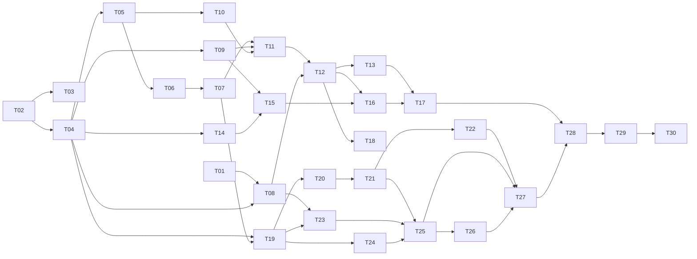

# Tasks 001 — Adaptive quiz (MVP)

- Status: Approved (2026-11-17), T02 amended and approved (2026-11-17)
- Date: 2026-11-17
- Constitution: 1.0.0
- Spec: [spec.md](spec.md) (Approved 2026-11-17, NFR-3 amended 2026-11-17)
- Plan: [plan.md](plan.md) (Approved 2026-11-17)

This document splits the approved plan into small tasks. Each task is independently verifiable and ships as one pull request.

## Conventions

- **One task, one branch, one pull request** (principle VII). Branch name: `001/T<nn>-<short-name>`, for example `001/T06-adaptation`. The pull request description links this file, the task id, and the spec criteria it covers.
- **Commits** follow Conventional Commits. Work done with an AI assistant carries a `Co-Authored-By` trailer.
- **Done** means: every item under "Done when" is true, `pnpm turbo lint typecheck test build` passes, and CI is green (from T03 on).
- **Tests never call the Anthropic API or Upstash** (principle VI). The only exception is the quality-gate script in T18, which is a manual check run by the project owner, not a test.
- **Owner actions** are steps only the project owner can take (accounts, keys, approvals). They are marked 👤.
- When a task shows that the plan or the spec is wrong, stop, update the document, and get it approved before continuing (principle I).

## Overview

| Phase | Tasks | Outcome |
| --- | --- | --- |
| 0. Groundwork | T01 to T03 | ADR 0005, monorepo scaffold, CI |
| 1. Contracts | T04 | Every schema in `shared-types` |
| 2. Core logic | T05 to T07 | Catalogue, adaptation, selection, evaluation, summary |
| 3. Runner | T08 | QuickJS test harness |
| 4. Server logic | T09 to T14 | Model adapter, prompts, generation, review, rate limits |
| 5. API | T15 to T17 | Hono app and both routes |
| 6. Quality gate | T18 | Model and prompts validated on real output (M1) |
| 7. Front-end | T19 to T26 | Complete quiz app |
| 8. End to end | T27 | Playwright suite in CI |
| 9. Release | T28 to T30 | Deployed demo, manual checks M2 to M5 |

---

## Phase 0 — Groundwork

### T01 — ADR 0005: run exercise code in QuickJS

- **Depends on:** none
- **Plan:** §9.2, §17 (D2)
- **Deliverables:** `docs/adr/0005-quickjs-sandbox-for-exercises.md` (context, options, decision, consequences), row added to the ADR index.
- **Done when:** 👤 the project owner accepts the ADR; status set to `Accepted`.

### T02 — Monorepo scaffold

- **Depends on:** none
- **Plan:** §3, §4
- **Deliverables:**
  - root `package.json` with `packageManager` and `engines` (Node 24, pnpm), `.nvmrc`, `pnpm-workspace.yaml`;
  - `turbo.json` with `build`, `lint`, `typecheck`, `test`, `test:e2e`, `dev`;
  - `tsconfig.base.json` (`strict`, `noUncheckedIndexedAccess`, `exactOptionalPropertyTypes`), `eslint.config.js` (flat config, `typescript-eslint`), `.prettierrc`, `vitest.config.ts` (Vitest projects, one per package);
  - empty `packages/shared-types` and `packages/core` (`@ai-in-learning/*`), each with a `tsc` build to `dist/`, an `exports` map including the `source` condition, and one smoke test.
- **Done when:** `pnpm install` then `pnpm turbo lint typecheck test build` passes from a clean clone; a test imports a package through the `source` condition without building it first.

### T03 — Continuous integration

- **Depends on:** T02; 👤 the repository is published on GitHub
- **Plan:** §14 (CI)
- **Deliverables:** `.github/workflows/ci.yml`: `pnpm install --frozen-lockfile`, then `pnpm turbo lint typecheck test build`, with the Turborepo cache. Branch protection on `main` requires the workflow.
- **Done when:** the workflow runs green on the pull request for this task, and a deliberately failing test makes it red (checked once, then reverted).

---

## Phase 1 — Contracts

### T04 — Shared schemas

- **Depends on:** T02
- **Plan:** §5, §7
- **Covers:** contract part of AC-2.1, AC-2.2, AC-5.1, AC-6.3, AC-8.4
- **Deliverables:** Zod schemas and inferred types in `packages/shared-types`:
  - `TopicId`, per-topic concept id enums (ids from plan §6.3), `QuestionKind`;
  - `SessionState`, `AnsweredQuestion` (stem at most 300 characters, at most 10 answers);
  - `Question` (discriminated union), `Option`, `Snippet`, `ExerciseTest`, `Json`;
  - `NextQuestionRequest/Response`, `CodeReviewRequest/Response` (code at most 5,000 characters);
  - `ApiError`, `ErrorCode`.
- **Done when:** unit tests show valid fixtures accepted and invalid ones rejected (option counts, concept id from the wrong topic, oversized stem or code); a test asserts that the review schema has no verdict field (AC-6.3).

---

## Phase 2 — Core logic (browser-safe)

### T05 — Concept catalogue, rubric and kind schedule

- **Depends on:** T04
- **Plan:** §6.2, §6.3, §8.3 (rubric)
- **Covers:** AC-5.1, AC-3.7 (exercise flags)
- **Deliverables:** in `@ai-in-learning/core`: the catalogue (id, label, description, `exercise` flag) for both topics, the five-level difficulty rubric, the kind schedule constant.
- **Done when:** tests show that every catalogue id matches the `shared-types` enum of its topic (both ways), that only the concepts marked "yes" in plan §6.3 are flagged `exercise`, and that the schedule has 10 entries with code at positions 4 and 8.

### T06 — Adaptation, evaluation and summary

- **Depends on:** T05
- **Plan:** §6.1, §6.5
- **Covers:** AC-2.4, AC-3.3, AC-4.1, AC-4.2, AC-4.3, AC-4.5, AC-7.1, AC-7.2
- **Deliverables:** `levelHistory`, `levelChange`, `evaluateChoice`, `evaluateCode`, `summarize`.
- **Done when:** table-driven tests cover: start at level 3; +1 and −1 with bounds 1 and 5; identical answers give identical levels; exact-set matching for multiple choice (exact, partial, superset, empty); code correct only when every test passes; score, final level, history, and mastered or to-review lists based on the latest attempt per concept.

### T07 — Concept selection and state consistency

- **Depends on:** T06
- **Plan:** §5 (validation), §6.4
- **Covers:** AC-5.2, part of AC-5.3 (no concept repeated without reason)
- **Deliverables:** seeded PRNG (mulberry32), `nextPosition`, `nextKind`, `selectNextConcept`, and `checkSessionState` (answers match the schedule, concepts belong to the topic, session not complete).
- **Done when:** tests show that: a missed concept comes back at the next compatible position, including a code slot for an exercise concept; a non-exercise missed concept waits for the next choice slot; a concept appears at most 3 times; new concepts are not reused while unused ones remain; the same `(topic, seed, answers)` always gives the same concept; inconsistent states are rejected.

---

## Phase 3 — Runner

### T08 — QuickJS test harness

- **Depends on:** T01 (accepted), T04
- **Plan:** §9.1, §9.2
- **Covers:** AC-3.2, AC-3.4, AC-3.5 (engine level)
- **Deliverables:** `@ai-in-learning/core/runner`:
  - QuickJS adapter for browser and Node: fresh runtime per run, interrupt deadline, 32 MB memory limit, bounded stack;
  - harness: `"use strict"` prefix, function lookup by name, JSON arguments, deep structural equality, immutability check, failure reasons from fixed templates (values truncated to 200 characters).
- **Done when:** tests run on Node with the real QuickJS build and show: a correct solution passes every test; a wrong one fails with the expected reason; a mutating solution fails the immutability test; `while (true) {}` stops with the timeout reason in under 4 s; code using `window`, `document`, `fetch`, `localStorage`, `import()` or `setTimeout` fails; two consecutive runs share no state.

---

## Phase 4 — Server logic (`core/server`)

### T09 — Model client and error mapping

- **Depends on:** T04
- **Plan:** §8.2, §11.3
- **Covers:** AC-8.1, AC-8.3 (mapping), AC-8.4 (no upstream detail)
- **Deliverables:** `ModelClient` interface; Anthropic adapter using `messages.parse()` with `zodOutputFormat`, the parameters from plan §8.2 as constants (model `claude-haiku-5-5`, `max_tokens`, effort, timeouts, `maxRetries: 1`, system prompt `cache_control`), `stop_reason` and `parsed_output` guards; `mapModelError`; a fake `ModelClient` for tests (in a test-only export).
- **Before coding:** confirm in the live Anthropic documentation the error returned when a workspace spend limit is reached, and note the source in the pull request.
- **Done when:** tests with mocked SDK errors show that timeout, connection errors, 429, 500 and 529 map to `ai_unavailable`; that billing and spend-limit errors map to `budget_exhausted`; that `refusal` and `max_tokens` count as invalid output; that anything else maps to `internal`; and that no mapped error carries the upstream message. A test asserts the request contains no `temperature`, `top_p`, `top_k` or `fallbacks`.

### T10 — Prompt builders

- **Depends on:** T05
- **Plan:** §8.3
- **Covers:** AC-3.7 (prompt), AC-5.2 (different angle), AC-5.3 (avoid list), NFR-6
- **Deliverables:** system prompt per topic and kind, user message builder (request block, revisit block, `<previous_questions>`), retry message builder, review prompt builder.
- **Done when:** snapshot tests exist for each topic and kind, a revisit, and a retry; tests assert that system prompts require English, forbid hooks and JSX in React exercises, and are identical across calls (cacheable); the retry message contains no client-supplied text.

### T11 — Question generation pipeline (choice questions)

- **Depends on:** T07, T09, T10
- **Plan:** §8.4 steps 1, 2, 4
- **Covers:** AC-2.1, AC-2.2, AC-5.3, NFR-3, NFR-5
- **Deliverables:** `generateQuestion()` for single and multiple choice: structure check, domain rules, near-duplicate check (word-trigram Jaccard, threshold 0.6), option shuffle with the session PRNG, ids `a` to `f`, at most one retry, `generation_failed` result.
- **Done when:** tests with the fake model and a set of broken fixtures (3 or 5 options, 0 or 2 correct, all correct in multiple choice, duplicate option text, near-duplicate stem, oversized fields) show each one rejected; a valid draft on the second attempt is returned; two invalid drafts give `generation_failed`; the model is never called more than twice per question.

### T12 — Code exercise pipeline

- **Depends on:** T08, T11
- **Plan:** §8.4 step 3, §9.1, §9.3, §7.2 (token)
- **Covers:** AC-3.6, AC-3.7, NFR-5
- **Deliverables:** code exercise path of `generateQuestion()`: static checks, JSON parsing of test arguments and expected values, solvability check with the runner (2 s), non-triviality check on the starter code, `exerciseToken` (HMAC-SHA-256, Web Crypto) with sign and verify functions.
- **Done when:** tests show that a reference solution failing one test is rejected and never returned; a starter code that already passes is rejected; React drafts with JSX, hooks, `import`, timers or `async` are rejected; malformed `argsJson` is rejected; a valid exercise comes back with a token that verifies, and any change to the exercise invalidates it.

### T13 — Code review service

- **Depends on:** T08, T09, T10, T12
- **Plan:** §10
- **Covers:** AC-6.2, AC-6.3
- **Deliverables:** `reviewCode()`: verify the token, re-run the tests on the visitor's code, build the prompt with the verdict stated as fact, parse the review (summary and 1 to 5 comments).
- **Done when:** tests with the fake model show that an invalid token is rejected before any model call; the prompt contains the server's own test results, not client-reported ones; the returned review has no verdict; one call per review.

### T14 — Rate limiting

- **Depends on:** T04
- **Plan:** §11.1
- **Covers:** NFR-4, AC-8.2, AC-8.3 (global cap)
- **Deliverables:** `RateLimiter` interface; Upstash adapter (`@upstash/ratelimit`, sliding window); limiter definitions as constants (`sessions` 5/h, `questions` 60/h, `reviews` 15/h, `global` 3,000/day, `quiz:` prefix); SHA-256 IP hashing; in-memory limiter in a test-only export.
- **Done when:** tests on the in-memory limiter show each limit and its reset time; a test with a mocked Redis client checks the key names and that raw IPs never appear in keys.

---

## Phase 5 — API

### T15 — Hono app skeleton

- **Depends on:** T09, T14
- **Plan:** §4 (`apps/api`), §7.3, §11.4, §14 (environment variables, entry point)
- **Covers:** AC-8.4, principle II
- **Deliverables:** `apps/api` with `app.ts` (no Vercel imports), `index.ts` (Vercel entry), `dev.ts` (`@hono/node-server`, port 8787), `env.ts` (Zod), `.env.example`, error catalogue and `onError`, `bodyLimit` (32 KB), `secureHeaders`, structured request logging.
- **Done when:** integration tests with `app.request()` show that an oversized body returns `invalid_request`; that a thrown error containing a fake key and a stack trace returns only the catalogue message; that missing environment variables give `internal` and log the variable name without a value; that log lines contain no raw IP. `pnpm --filter api dev` serves the app locally.

### T16 — `POST /api/quiz/next-question`

- **Depends on:** T12, T15
- **Plan:** §7.1, §11.1, §12
- **Covers:** AC-3.6, AC-4.5, AC-5.1, AC-8.1, AC-8.2, AC-8.3, NFR-3, NFR-4
- **Deliverables:** route wired to `checkSessionState`, the limiters, and `generateQuestion`.
- **Done when:** integration tests with the fake model and in-memory limiter show: a valid first request returns question 1 at level 3; the response level comes from `answers`, whatever the model returns; every response parses with `NextQuestionResponse`; an inconsistent or complete state returns `invalid_request`; the 6th session in an hour returns 429 with `Retry-After` and `retryAfterSeconds`; forged non-empty states hit the `questions` limit; the global cap returns `budget_exhausted`; a limiter failure returns `ai_unavailable` without calling the model (fail closed); model errors map as in T09; two invalid drafts return `generation_failed`.

### T17 — `POST /api/quiz/code-review`

- **Depends on:** T13, T16
- **Plan:** §7.2, §10
- **Covers:** AC-6.2, AC-6.3, NFR-3
- **Deliverables:** route wired to the `reviews` limiter and `reviewCode`.
- **Done when:** integration tests show a review for a valid request; `invalid_request` for a tampered exercise; 429 after 15 reviews in an hour; responses parse with `CodeReviewResponse`.

---

## Phase 6 — Quality gate

### T18 — Question sampling script and quality gate M1

- **Depends on:** T12; 👤 Anthropic workspace for the quiz, with its own key and a spend limit (plan §11.2)
- **Plan:** §8.1, §16.3 (M1)
- **Covers:** NFR-5, NFR-6, AC-5.3 (manual part), D1 escalation rule
- **Deliverables:** `apps/api/scripts/sample-questions.ts`, excluded from `turbo test`. It generates 30 questions per topic across levels and kinds with the real adapter, writes them to a local file ignored by git, and prints token usage. Also `specs/001-adaptive-quiz-mvp/checks.md` with the M1 checklist and results.
- **Done when:** 👤 the project owner reviews the sample and records the result in `checks.md`: at most 2 defective questions per topic, measured cost per session written down. If the gate fails after prompt tuning, a plan amendment moving generation to Claude Sonnet 5.5 is proposed and approved before any further task depends on it.

---

## Phase 7 — Front-end

### T19 — Quiz app shell, home and session flow

- **Depends on:** T04, T07
- **Plan:** §13.1, §13.2 (Home, Error state), §13.3
- **Covers:** AC-1.1, AC-1.2, AC-1.3, AC-8.1, AC-8.2, AC-8.3, AC-8.4, NFR-1
- **Deliverables:** `apps/quiz` (Vite, React, CSS Modules, design tokens), Vite proxy to port 8787, ESLint rule forbidding `@ai-in-learning/core/server`, `ApiClient` context and typed fetch client (parses responses, 65 s timeout), session reducer, `Home`, `SessionHeader`, loading state, `ErrorState` with catalogue messages and Retry, `vitest-axe` setup.
- **Done when:** component tests with a fake `ApiClient` show: home content and AI notice; Start shows the loading indicator in the render right after the click, then question 1 (placeholder rendering is enough at this stage); topic, "Question n of 10" and level always visible; each error code shows its catalogue message; Retry resends the same state and keeps progress; a malformed response is shown as `internal`. axe finds no violations on these screens.

### T20 — Choice questions and snippets

- **Depends on:** T19
- **Plan:** §9.5 (highlighting), §13.3
- **Covers:** AC-2.1, AC-2.2, AC-2.3, AC-2.5
- **Deliverables:** `SingleChoice` (radio group), `MultipleChoice` (fieldset of checkboxes, "Select all that apply"), `CodeSnippet` (static highlighting with `@lezer/highlight`), Submit that stays inert until an option is selected.
- **Done when:** component tests show one selection in single choice, several in multiple choice, the "Select all that apply" text, Submit blocked without a selection (with its hint), highlighted snippets; axe passes; the whole question can be answered with the keyboard.

### T21 — Feedback, level change and prefetch

- **Depends on:** T20
- **Plan:** §12 (prefetch), §13.2 (Feedback)
- **Covers:** AC-4.4, AC-6.1, AC-6.4, NFR-1, NFR-3
- **Deliverables:** `Feedback` for choice questions (verdict with icon and words, correct options, explanation), `LevelChangeNotice` in a polite live region, prefetch of the next question as soon as an answer is evaluated, "Next question", focus moved to the new heading on each screen.
- **Done when:** component tests show the feedback content; "Level up: 4/5" and the level-down message; exactly one request per question even with prefetch; "Next question" shows the prefetched question at once or a loading state; a prefetch error surfaces on "Next question" with Retry.

### T22 — Summary

- **Depends on:** T21
- **Plan:** §13.2 (Summary), §13.3 (chart)
- **Covers:** AC-7.1, AC-7.2, AC-7.3, NFR-3 (no request)
- **Deliverables:** `Summary` with score, final level, `LevelChart` (inline SVG, text alternative, visually hidden table), concepts mastered and to review, "Same topic" and "Other topic".
- **Done when:** component tests show every element, no API call when the summary appears, and both restart paths starting a fresh session; axe passes.

### T23 — Runner worker

- **Depends on:** T08, T19
- **Plan:** §9.2 (browser column)
- **Covers:** AC-3.4, AC-3.5 (browser side)
- **Deliverables:** `runner.worker.ts` using `core/runner`; `runnerClient.ts` with the 5 s backstop (terminate and recreate the worker); lazy loading of the QuickJS WebAssembly when a session starts.
- **Done when:** unit tests of `runnerClient` with a fake worker show results passed through, the backstop firing on a silent worker, and a working worker after recreation. Real-browser behaviour is covered in T27.

### T24 — Code editor component

- **Depends on:** T19
- **Plan:** §9.5
- **Covers:** NFR-2 (editor), AC-3.1 (editor part)
- **Deliverables:** `CodeEditor` on CodeMirror 6: JavaScript language, Tab indentation with the Escape-then-Tab exit, visible hint linked with `aria-describedby`, accessible name through `contentAttributes`, read-only mode, visible focus.
- **Done when:** component tests show the accessible name, the hint, and the read-only mode; axe passes. Keyboard exit is verified in a real browser in T27.

### T25 — Code exercise screen and code feedback

- **Depends on:** T21, T23, T24
- **Plan:** §9.4, §10 (front-end), §13.2
- **Covers:** AC-3.1, AC-3.2, AC-3.3, AC-6.2, AC-6.3
- **Deliverables:** `CodeExercise` (statement, editor with starter code, list of what the tests check, "Run tests", `TestResults`, Submit that freezes the editor); code feedback (test results, reference solution, AI review with its own loading, error and Retry states, "Next question" always available).
- **Done when:** component tests with a fake runner and fake API show: tests can be run several times; Submit records the verdict from tests and makes the editor read-only; feedback shows results and reference solution at once, then the review; a review saying the code is wrong on passing tests still shows "Correct"; a failed review shows "The AI review is unavailable" with Retry and does not block "Next question"; one review request per submission.

### T26 — Quiz deployment configuration and bundle check

- **Depends on:** T25
- **Plan:** §9.5 (CSP), §14 (rewrite, security headers, bundle check)
- **Covers:** principle II, AC-3.5 (defence in depth)
- **Deliverables:** `apps/quiz/vercel.json` with the `/api/:path*` rewrite and security headers (CSP including `'wasm-unsafe-eval'`, CodeMirror styles handled by nonce or `'unsafe-inline'`, documented in the pull request); `apps/api/vercel.json` with `maxDuration: 60`; a script that fails if `apps/quiz/dist` contains `sk-ant`, `ANTHROPIC` or `UPSTASH`, wired into CI.
- **Done when:** the built app runs under the CSP with no violations in the console (checked with `vite preview` and the same headers); the bundle check passes, and fails on a planted test string (checked once, then reverted).

---

## Phase 8 — End to end

### T27 — Playwright suite

- **Depends on:** T22, T25, T26
- **Plan:** §16.1, §16.2
- **Covers:** AC-1.2, AC-3.2, AC-3.4, AC-3.5, NFR-2, NFR-3, plus a full-flow check of every P1 story
- **Deliverables:** Playwright (Chromium) and `@axe-core/playwright` in `apps/quiz/e2e`, API mocked with `page.route` and recorded fixtures for both topics, `test:e2e` task, CI job against the built app.
- **Done when:** these scenarios pass in CI:
  - a full session per topic, keyboard only, from home to summary, including leaving the editor with Escape then Tab;
  - an infinite loop: the page stays interactive during the run, and the timeout message appears;
  - code reading `document.title` fails inside the exercise;
  - exactly 10 question requests and 2 review requests per session, and none for the summary;
  - axe scans with no violations on every screen.

---

## Phase 9 — Release

### T28 — Infrastructure and first deployment

- **Depends on:** T17, T27; 👤 Vercel and Upstash accounts
- **Plan:** §11.2, §14
- **Covers:** deployment part of ADR 0002, ADR 0003, ADR 0004; manual checks M3, M4
- **Deliverables:**
  - 👤 Upstash Redis database; 👤 two Vercel projects (Root Directory `apps/quiz` and `apps/api`, Ignored Build Step `npx turbo-ignore`), production environment variables on the API project only, deployment protection on previews;
  - rewrite destination set to the API's production domain;
  - results of M3 (visitor IP reaches the API through the rewrite) and M4 (spend-limit message, on a test workspace with a tiny limit) recorded in `checks.md`.
- **Done when:** the production demo completes a session; a commit touching only `apps/quiz` skips the API build (and the other way round); M3 and M4 pass. If M3 fails, stop and propose the ADR described in plan §14 before going further.

### T29 — Latency, accessibility and layout checks

- **Depends on:** T28
- **Plan:** §16.3 (M2, M5)
- **Covers:** NFR-1, NFR-2, NFR-7
- **Deliverables:** results of M2 (3 sessions per topic, time to next question) and M5 (VoiceOver with Safari, keyboard only, at 1024 px and 1440 px) recorded in `checks.md`. Any defect found becomes a fix in this task, or a new task if it is large.
- **Done when:** M2 shows a median under 5 s without prefetch; M5 completes a full session with no focus trap; `checks.md` lists every manual check with date and result.

### T30 — Release review

- **Depends on:** T29
- **Plan:** §2, §16.2
- **Deliverables:** a pull request that marks the spec, plan and tasks as implemented, links `checks.md`, and confirms the traceability table below against the test suite (every listed test exists and passes).
- **Done when:** 👤 the project owner approves the release.

---

## Traceability: criteria to tasks

| Criterion | Tasks |
| --- | --- |
| AC-1.1 | T19 |
| AC-1.2 | T19, T27 |
| AC-1.3 | T19 |
| AC-2.1 | T04, T11, T20 |
| AC-2.2 | T04, T11, T20 |
| AC-2.3 | T20 |
| AC-2.4 | T06 |
| AC-2.5 | T20 |
| AC-3.1 | T24, T25 |
| AC-3.2 | T08, T25, T27 |
| AC-3.3 | T06, T25 |
| AC-3.4 | T08, T23, T27 |
| AC-3.5 | T08, T23, T26, T27 |
| AC-3.6 | T12, T16 |
| AC-3.7 | T05, T10, T12 |
| AC-4.1 | T06 |
| AC-4.2 | T06 |
| AC-4.3 | T06 |
| AC-4.4 | T21 |
| AC-4.5 | T06, T16 |
| AC-5.1 | T04, T05, T16 |
| AC-5.2 | T07, T10 |
| AC-5.3 | T07, T10, T11, T18 |
| AC-6.1 | T21 |
| AC-6.2 | T13, T17, T25 |
| AC-6.3 | T04, T13, T17, T25 |
| AC-6.4 | T21 |
| AC-7.1 | T06, T22 |
| AC-7.2 | T06, T22 |
| AC-7.3 | T22 |
| AC-8.1 | T09, T16, T19 |
| AC-8.2 | T14, T16, T19 |
| AC-8.3 | T09, T14, T16, T19, T28 (M4) |
| AC-8.4 | T09, T15, T19 |
| NFR-1 | T19, T21, T29 (M2) |
| NFR-2 | T20, T24, T27, T29 (M5) |
| NFR-3 | T11, T13, T16, T21, T22, T27 |
| NFR-4 | T14, T16 |
| NFR-5 | T11, T12, T18 (M1) |
| NFR-6 | T10, T18 (M1) |
| NFR-7 | T29 |
